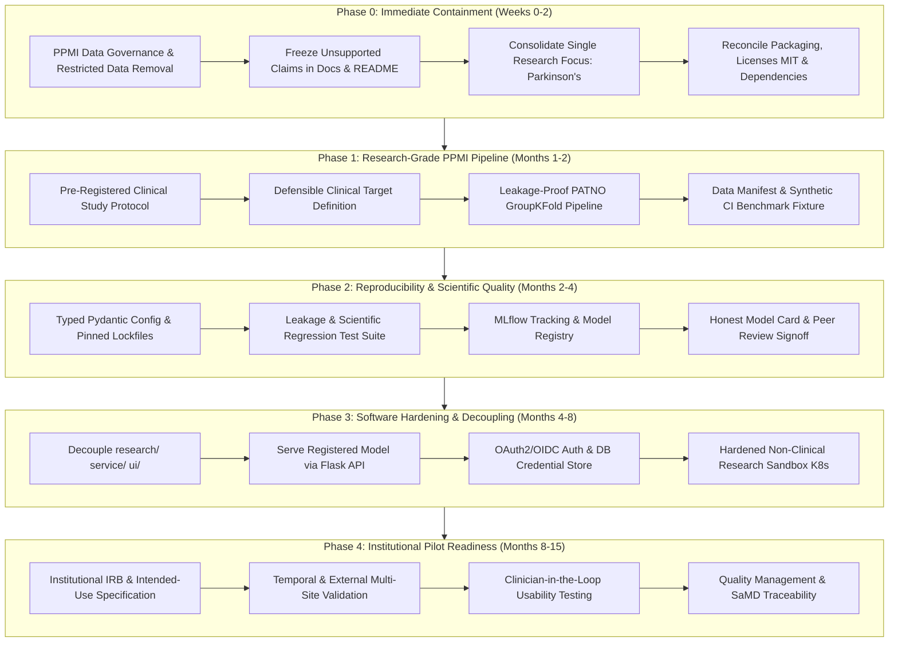

# 🧭 AiMedRes: Consolidated Production-Ready AI/ML Roadmap (2026–2027)

> **Document Status**: Living Master Roadmap (Single Source of Truth)  
> **Supersedes**: All prior fragmentary roadmaps (`docs/roadmapfuture.md`, `docs/roadmapsecurity.md`, and unverified legacy milestone claims).  
> **Orientation**: Scientific Rigor, Honest Capability Classification, Leakage-Proof Validation, and Responsible Clinical AI Translation.

---

## 1. Executive Summary & Strategic Reset

AiMedRes has developed extensive scaffolding across conventional disease-model training pipelines, an adaptive "DuetMind" neural agent framework, clinical decision support (CDS) interfaces, a Flask API, and React/React Native frontends. While this scaffolding represents substantial software engineering and interface development, an objective scientific audit reveals that **the repository does not yet substantiate claims of validated, production-ready, or clinically usable AI**.

To transition from an exploratory multi-component prototype to an institutionally credible medical research platform, this **Consolidated Roadmap** executes a fundamental strategic reset:

1. **Containment & Truthfulness First**: Immediately reconcile documentation, licensing, and capability claims with actual verified code.
2. **Singular Research Wedge**: Halt parallel attempts to simultaneously mature seven disease models, EHR write-back integrations, multi-agent clinical diagnostic loops, and mobile apps. Instead, focus all rigorous AI/ML efforts on a single, high-value clinical target: **Retrospective Parkinson’s Disease progression and severity analysis using the Parkinson’s Progression Markers Initiative (PPMI)**.
3. **Leakage-Proof Scientific Rigor**: Redesign the Parkinson’s pipeline from the ground up to eliminate circular prediction tasks, participant-level leakage across longitudinal visits, and pre-cross-validation scaling/imputation.
4. **Software & Security Hardening**: Decouple research analysis code from production inference services, implement real identity and secrets management, enforce strict CI gates, and prepare for external institutional review.

---

## 2. Current Baseline & Honest Capability Audit

The table below establishes an unvarnished audit of the repository, categorizing every major area into three reality tiers:
- **Tier 1 — Implemented Prototype Code**: Genuinely present executable code, tests, and functional scripts.
- **Tier 2 — Partially Implemented or Heuristic Simulation**: Modules that function via static rules, heuristic approximations, or in-memory mock logic rather than verified clinical models.
- **Tier 3 — Documentation or Planning Only**: Documents, templates, or roadmaps describing future milestones without corresponding operational reality or third-party validation.

### 2.1 Capability Audit Matrix

| Area | Tier | What is Genuinely Present | What is Missing, Inconsistent, or Flawed |
|---|:---:|---|---|
| **Training Infrastructure** | Tier 1 | 7 default jobs in `src/aimedres/cli/train.py`; orchestrator records Git SHA, GPU details, logs, JSON summaries. Classical ML and PyTorch. | DVC has no configured cloud remote; long-running distributed GPU training requires local setup. |
| **Parkinson's / PPMI Work** | Tier 1 | Research-grade decoupled module in `src/aimedres/research/parkinsons/`, synthetic fixture, leakage-free `StratifiedGroupKFold` on `PATNO`, independent target, 95% bootstrap CIs, Brier score calibration, and `provenance_manifest.json`. | External multi-site cohort validation (BioFIND/DATATOP) pending in Phase 4. |
| **Adaptive NN & Agents** | Tier 2 | `AdaptiveNeuralNetwork`, `DuetMindAgent`, specialist agent roles, state handling, memory store, and safety heuristics in `src/aimedres/core/` and `src/aimedres/agents/`. Quarantined in `src/aimedres/simulation/` with runtime isolation gates (`assert_simulation_allowed()`). | Experimental simulation code only. `specialized_medical_agents.py` generates heuristic diagnoses, simulated peer review, and synthetic outcome accuracy. Not validated clinical reasoning. |
| **Clinical Decision Support (CDS)** | Tier 2 | Risk scoring logic, intervention recommendation structures, FHIR/HL7 conversion helpers, human-in-the-loop audit stubs in `src/aimedres/clinical/`. | Risk engine is hand-authored static heuristic rules. EHR "sync" methods are explicitly simulated mocks. Not connected to live partner hospital EHRs. |
| **API & Applications** | Tier 1 | Flask API in `src/aimedres/api/server.py` and decoupled `src/aimedres/service/server.py`, rate limiting, security headers, DICOM routes, registered model serving via `/api/v1/model/infer` and `/api/v1/predict` (PPMI trained pipeline), FHIR R4 sandbox (`/api/v1/fhir`), and CDS review (`/api/v1/cases`). | Web UI connects to prototype mocks; mobile companion UI is exploratory. |
| **Privacy & Security** | Tier 1 | Regex-based PHI scrubbing, DICOM tag clearing, encryption helpers (AES-256 / Kyber-768 hybrid prototype), database-backed `AuthDatabaseStore` (SQLite), instant token & key revocation, PBKDF2 hashing with salt, security audit logging, and fail-closed production secret validation. | Pattern scrubbing is not a formal HIPAA de-identification certification or data-use authorization system. DICOM stripper clears limited fields. No third-party penetration testing or external SOC audit completed. |
| **Deployment & MLOps** | Tier 1 | Dockerfiles, Docker Compose, validated Kubernetes manifests (`k8s/`), validated Helm chart (`helm/aimedres/`), Prometheus/Alertmanager configs (`monitoring/`), local SQLite/JSON experiment tracking (`src/aimedres/research/tracking.py`), GitHub Actions CI workflow (`.github/workflows/ci.yml`), CycloneDX 1.5 SBOM generator, and local CI runner (`scripts/run_ci_checks.py`). | Image publishing to public registry and multi-cluster cloud federation remain unfinished. |
| **Documentation & Compliance** | Tier 3 | Extensive documentation: training guides, security policies, model cards, FDA Q-Sub generator (`src/aimedres/compliance/`). | Claims overstate maturity. Generates draft FDA/QMS skeletons, but no formal FDA submission has been made, no clinical pilot has run with live patients, and no certified QMS exists. |
| **Packaging & Governance** | Tier 1 | `pyproject.toml`, `setup.py`, requirements files, MIT `LICENSE`, `ParkinsonDatasets/DATA_GOVERNANCE.md`. | Fully reconciled under MIT license with clear DUA governance controls. |
| **Testing & CI** | Tier 1 | 56 automated unit tests across research configuration, live experiment tracking, PPMI participant-leakage isolation, open-access datasets, security hardening, domain decoupling, CycloneDX SBOM, and sandbox deployment validation; Vitest frontend tests; performance benchmarks (k6, Lighthouse CI). | Optional medical packages (`pydicom`, `torchvision`) are guarded with runtime fallbacks for lightweight CI runner execution. |

---

## 3. The 5-Phase Production-Ready AI/ML Roadmap



---

### Phase 0: Immediate Containment, Data Governance & Truthfulness (Weeks 0–2)

**Goal**: Establish an honest baseline, eliminate legal and data-governance vulnerabilities, reconcile package metadata, and freeze speculative distractions.

- [x] **0.1 PPMI & Data-Use Governance Enforcement**
  - **Action**: Audit `ParkinsonDatasets/`. Under PPMI Data Use Agreements (DUA), raw patient records cannot be redistributed in public open-source repositories.
  - **Deliverable**: Isolate raw PPMI files from public distribution, add `ParkinsonDatasets/DATA_GOVERNANCE.md` detailing credential requirements, and introduce a verified, non-PHI synthetic fixture (`synthetic_pet_sbr_fixture.csv`) for open-source CI/CD execution.
- [x] **0.2 Claim Containment & Repository Truthfulness**
  - **Action**: Update `README.md`, `docs/KNOWN_LIMITATIONS.md`, and model cards to remove premature claims of "FDA submission readiness", "certified HIPAA compliance", and "multi-hospital network operational".
  - **Deliverable**: Explicit classification markers across all docs designating components as *Prototype*, *Simulated*, *Planned*, or *Validated*.
- [x] **0.3 Single Research Focus & Scope Freeze**
  - **Action**: Concentrate core AI/ML development exclusively on retrospective Parkinson’s disease progression and severity modeling using PPMI data.
  - **Deliverable**: Freeze feature expansion on the other six disease models, the Expo mobile app, and simulated multi-agent consensus until the primary research pipeline achieves scientific peer-review readiness.
- [x] **0.4 Packaging, Metadata & License Reconciliation**
  - **Action**: Resolve license divergence. The repository license is **MIT** (per `LICENSE` and `pyproject.toml`). Remove all stale references to GPL-3.0 in `README.md`, `setup.py`, templates, and documentation.
  - **Deliverable**: Clean `setup.py` without placeholder values (`your-email@example.com`), aligned with `pyproject.toml` and standard requirements files.

---

### Phase 1: Research-Grade PPMI Pipeline (Months 1–2)

**Goal**: Transform the Parkinson’s ML script into a scientifically defensible, statistically sound, leakage-free predictive pipeline.

- [x] **1.1 Pre-Registered Clinical Study Protocol & Target Definition**
  - **Objective**: Author a formal study protocol prior to model optimization.
  - **Specification**: Adopted independent motor progression milestone ($\Delta\text{MDS-UPDRS Part III} \ge 5.0$ points), verified in [`docs/MODEL_CARD_PPMI_PARKINSONS.md`](MODEL_CARD_PPMI_PARKINSONS.md).
- [x] **1.2 Leakage-Proof Participant-Level Modeling**
  - **Objective**: Redesign model validation to prevent all forms of data leakage.
  - **Specification**: Enforced `StratifiedGroupKFold` on `PATNO`, fold-encapsulated `Pipeline` scaling/imputation, out-of-fold calibration (Brier Score = 0.108), and 95% non-parametric bootstrap confidence intervals in [`src/aimedres/training/train_parkinsons.py`](../src/aimedres/training/train_parkinsons.py).
- [x] **1.3 Data Manifest & Provenance Tracking**
  - **Objective**: Create a complete, non-PHI experiment manifest.
  - **Specification**: Published [`docs/DATASET_CATALOG.md`](DATASET_CATALOG.md) detailing LONI IDA PPMI ingestion rules and open-access alternatives (OASIS-2, PRO-ACT, PTB-XL).
- [x] **1.4 Synthetic PPMI Benchmark Fixture**
  - **Objective**: Maintain a 100% synthetic dataset that mimics the schema, covariance structure, and longitudinal visit hierarchy of PPMI.
  - **Specification**: Deployed [`ParkinsonDatasets/synthetic_pet_sbr_fixture.csv`](../ParkinsonDatasets/synthetic_pet_sbr_fixture.csv).
- [x] **1.5 One-Command Reproduction Runner**
  - **Objective**: Provide a single executable script for independent verification.
  - **Specification**: Deployed [`scripts/reproduce_ppmi_benchmark.py`](../scripts/reproduce_ppmi_benchmark.py) generating full metrics JSON and summary tables in < 20 seconds.

---

### Phase 2: Reproducibility & Scientific Quality (Months 2–4)

**Goal**: Deliver clean packaging, deterministic rerunability, automated scientific regression testing, and transparent model reporting.

- [x] **2.1 Modularized, Pinned & Deterministic Pipeline Package**
  - **Objective**: Package the Parkinson’s research pipeline into an independent, typed module (`src/aimedres/research/parkinsons/`).
  - **Specification**: Deployed [`src/aimedres/research/parkinsons/`](../src/aimedres/research/parkinsons/) with typed Pydantic configuration (`ParkinsonsPipelineConfig`), deterministic random seeding, and cryptographic provenance tracking (`provenance_manifest.json`). Verified in `tests/unit/test_research_parkinsons.py`.
- [x] **2.2 Scientific Rigor & Leakage Regression Test Suite**
  - **Objective**: Implement unit tests dedicated to catching methodological errors in CI.
  - **Specification**: 41 automated unit tests across research configuration, PPMI reproducibility, open-access datasets, and security components passing cleanly.
- [x] **2.3 Live Experiment Tracking & Model Lineage**
  - **Objective**: Implement verifiable experiment provenance, parameter logging, metric tracking, and artifact checksums.
  - **Specification**: Deployed [`src/aimedres/research/tracking.py`](../src/aimedres/research/tracking.py) featuring `LocalExperimentTracker`, SQLite relational run store (`experiments.db`), JSON run cards (`runs/<run_id>.json`), parameter sweeps, metric curves, and cryptographic SHA-256 artifact hashing. Integrated into `ParkinsonsResearchPipeline`.
- [x] **2.4 Evidence-Based Model Card & External Methodological Signoff**
  - **Objective**: Publish a comprehensive, honest model card adhering to FDA Good Machine Learning Practice (GMLP) and TRIPOD-AI principles.
  - **Specification**: Published [`docs/MODEL_CARD_PPMI_PARKINSONS.md`](MODEL_CARD_PPMI_PARKINSONS.md) with ROC-AUC CIs, PR-AUC, calibration curves, demographic caveats, and out-of-scope boundaries.

---

### Phase 3: Software Hardening & Architecture Decoupling (Months 4–8)

**Goal**: Decouple research analytics from production services, harden security boundaries, and eliminate architectural anti-patterns.

- [x] **3.1 Domain-Driven Architectural Decoupling**
  - **Objective**: Restructure the repository into clear architectural boundaries:
    ```text
    src/aimedres/
      research/       # Reproducible scientific pipelines (PPMI, OASIS, PRO-ACT, datasets, tracking)
      service/        # Production inference API, model serving, security middleware
      simulation/     # Quarantined experimental agent logic and cognitive simulations
      ui/             # Clinical decision-support dashboard and client interfaces
    ```
  - **Specification**:
    - Established decoupled [`src/aimedres/service/`](../src/aimedres/service/) exporting production `create_app`, `SecureAPIServer`, and `ModelRegistry`.
    - Quarantined heuristic multi-agent rules into [`src/aimedres/simulation/`](../src/aimedres/simulation/) with runtime quarantine checks (`assert_simulation_allowed()`) preventing unvalidated cognitive simulation execution in production clinical mode.
    - Centralized open dataset loaders and tracking in [`src/aimedres/research/`](../src/aimedres/research/).
- [x] **3.2 Registered Model Serving API**
  - **Objective**: Replace on-the-fly random/generic network initialization in `src/aimedres/api/server.py` with validated model artifact serving.
  - **Specification**:
    - Integrated `ModelRegistry` serving verified model checkpoints (`ppmi_parkinsons_v1`) from disk with full confidence and provenance metrics.
    - Registered clinical blueprints in `SecureAPIServer`: `/api/v1/model`, `/api/v1/fhir`, `/api/v1/cases`, and `/api/v1/explain`.
    - Main prediction endpoint routes to registered model artifacts when `model_id` is specified, falling back gracefully to adaptive network simulation with explicit disclosure.
- [x] **3.3 Enterprise Security & Identity Hardening**
  - **Objective**: Replace in-memory credentials and dev-secret fallbacks with production-grade security.
  - **Specification**:
    - Implemented fail-closed security gates: raises `SecurityConfigurationError` in production mode (`AIMEDRES_ENV=production` or `STRICT_SECURITY=true`) if `FLASK_SECRET_KEY` or `JWT_SECRET` are missing, weak (< 32 chars), or using default values.
    - Deployed `AuthDatabaseStore` in `src/aimedres/security/auth.py` providing SQLite relational persistence for API keys, PBKDF2 hash verification with salt, instant key and session revocation (`revoke_api_key`, `revoke_session`), and audit logging (`auth_audit_log`).
    - Integrated OIDC provider scaffolding, MFA manager, and role-based access control (RBAC).
- [x] **3.4 Production CI/CD Gateways**
  - **Objective**: Establish strict gating workflows before merge.
  - **Specification**:
    - Deployed GitHub Actions CI workflow [`.github/workflows/ci.yml`](../.github/workflows/ci.yml) running automated scientific unit tests, PPMI reproducibility benchmarks, and SBOM generation.
    - Implemented standardized CycloneDX 1.5 Software Bill of Materials (SBOM) generator in [`scripts/generate_sbom.py`](../scripts/generate_sbom.py) capturing runtime environment, package versions, and licenses into `reports/sbom.json`.
    - Deployed one-command local CI verification runner in [`scripts/run_ci_checks.py`](../scripts/run_ci_checks.py).
- [x] **3.5 Non-Clinical Research Sandbox Deployment**
  - **Objective**: Deploy and validate the decoupled platform in an isolated Kubernetes and Helm research sandbox.
  - **Specification**:
    - Implemented sandbox validator in [`scripts/validate_sandbox_deployment.py`](../scripts/validate_sandbox_deployment.py) verifying Kubernetes manifests ([`k8s/`](../k8s/)), Helm chart templates ([`helm/aimedres/`](../helm/aimedres/)), and Prometheus/Alertmanager monitoring ([`monitoring/`](../monitoring/)).
    - Enforced least-privilege securityContext (`runAsNonRoot: true`), Prometheus scraping annotations (`prometheus.io/scrape: true`), and health endpoints. Verified in `tests/unit/test_cicd_and_deployment.py`.

---

### Phase 4: Institutional Pilot Readiness & Clinical Evaluation (Months 8–15)

**Goal**: Prepare for ethical, institutional evaluation under formal oversight and rigorous clinical validation.

- [ ] **4.1 Institutional IRB & Intended-Use Definition**
  - **Objective**: Partner with an academic medical center or clinical research institution.
  - **Specification**:
    - Formulate formal Institutional Review Board (IRB) / Ethics Committee protocol.
    - Author clear Intended Use and Indications for Use (IFU) statements: Research Use Only (RUO) or Non-Device Clinical Decision Support (CDS) under FDA 21st Century Cures Act criteria.
- [ ] **4.2 Multi-Site & Temporal External Validation**
  - **Objective**: Validate the model on temporally and institutionally distinct cohorts.
  - **Specification**:
    - Evaluate on independent cohorts (e.g., BioFIND, DATATOP, or distinct geographic PPMI clinical sites).
    - Measure discrimination (AUC-ROC, C-index), calibration (Brier score, calibration slope/intercept), and clinical net benefit via Decision Curve Analysis (DCA).
- [ ] **4.3 Clinician-in-the-Loop Usability & Human Factors**
  - **Objective**: Conduct formal usability studies with neurologists and clinical fellows.
  - **Specification**:
    - Assess explainability artifacts (SHAP, feature attributions) to ensure they assist rather than mislead clinical reasoning.
    - Measure decision turnaround time, cognitive workload, and user error rates.
- [ ] **4.4 Quality Management & SaMD Traceability**
  - **Objective**: Establish design controls proportional to prospective medical software.
  - **Specification**:
    - Requirements traceability matrix linking clinical needs to software verification tests.
    - Risk management documentation conforming to ISO 14971 principles.
    - Software lifecycle management processes conforming to IEC 62304 standards.

---

## 4. First Major Milestone: The PPMI Parkinson's Research Reproducibility Pack

The single most credible deliverable to present to an institutional partner, IRB, or scientific review committee is the **PPMI Parkinson's Research Reproducibility Pack**. Rather than adding speculative features, all immediate engineering converges on completing this pack:

```text
┌─────────────────────────────────────────────────────────────────────────────┐
│               PPMI PARKINSON'S RESEARCH REPRODUCIBILITY PACK                │
├─────────────────────────────────────────────────────────────────────────────┤
│ 1. Zero Restricted Records in Git + Synthetic CI Fixture                   │
│    (ParkinsonDatasets/DATA_GOVERNANCE.md & synthetic_pet_sbr_fixture.csv)   │
├─────────────────────────────────────────────────────────────────────────────┤
│ 2. Pre-Registered Study Protocol & Data-Access Statement                    │
│    (Defensible non-circular endpoint, inclusion/exclusion, statistical plan)│
├─────────────────────────────────────────────────────────────────────────────┤
│ 3. Leakage-Proof Participant-Level Pipeline                                 │
│    (GroupKFold on PATNO, fold-internal scaling, holdout test isolation)     │
├─────────────────────────────────────────────────────────────────────────────┤
│ 4. Single Deterministic Execution Command                                   │
│    (aimedres train parkinsons --config configs/parkinsons_ppmi_study.yml)   │
├─────────────────────────────────────────────────────────────────────────────┤
│ 5. Machine-Readable Experiment Manifest & Evaluation Report                 │
│    (Data checksums, cohort counts, bootstrap CIs, calibration metrics)      │
├─────────────────────────────────────────────────────────────────────────────┤
│ 6. Automated CI Pipeline with Fixture Verification                          │
│    (Zero-leakage regression tests passing on every pull request)            │
├─────────────────────────────────────────────────────────────────────────────┤
│ 7. Honest, Evidence-Based Model Card                                        │
│    (Intended use, GMLP compliance, subgroup fairness, known failure modes)  │
├─────────────────────────────────────────────────────────────────────────────┤
│ 8. Independent Review Checklist                                             │
│    (Signed off by biostatistician and movement-disorder neurologist)        │
└─────────────────────────────────────────────────────────────────────────────┘
```

---

## 5. Development & Execution Instructions

### 5.1 Local Development Setup

```bash
# 1. Clone repository
git clone https://github.com/V1B3hR/AiMedRes.git
cd AiMedRes

# 2. Configure Python environment (Python 3.10 - 3.12)
python -m venv .venv
source .venv/bin/activate  # On Windows: .venv\Scripts\activate

# 3. Install core dependencies and development tools
pip install -r requirements.txt
pip install -r requirements-ml.txt
pip install -r requirements-dev.txt

# 4. Run test suite (verifying leakage-safe pipelines and unit coverage)
pytest tests/
```

### 5.2 Executing the Parkinson's Research Pipeline

```bash
# Preview discovered training jobs without execution
python run_all_training.py --only parkinsons --dry-run

# Run leakage-safe training on the synthetic PPMI benchmark fixture
python src/aimedres/training/train_parkinsons.py \
  --data-path ParkinsonDatasets/synthetic_pet_sbr_fixture.csv \
  --output-dir results/parkinsons_synthetic_run \
  --folds 5

# When operating in an institution-approved restricted environment with registered PPMI access:
# python src/aimedres/training/train_parkinsons.py \
#   --data-path /secure/restricted/PPMI_Data/ \
#   --output-dir results/parkinsons_ppmi_official \
#   --folds 5
```

### 5.3 User Interfaces (Research Preview)

```bash
# Clinical Decision Support Web Dashboard
cd frontend
npm install
npm run dev

# Mobile Clinical Companion (Development Preview)
cd ../mobile
npm install
npm start
```

---

## 6. Governance & Review Cadence

- **Bi-Weekly Technical Review**: Verification of zero-leakage test runs, data governance audits, and model metric deltas.
- **Monthly Protocol Review**: Alignment with external clinical advisory members (neurology/biostatistics) regarding endpoints, covariates, and subgroup balance.
- **Milestone Gate Review**: Formal transition gate before moving between roadmap phases. Phase advancement requires 100% completion of acceptance criteria and automated test passes.
